  
  
  
   
  
  
  
  

---

  

 

<h3 align="center">⚡ Core Focus &amp; Methodology</h3>

<table>
  <tr>
    <td width="50%" valign="top">
      <h4>🧠 Binary Exploitation &amp; Security Research</h4>
      <ul>
        <li><b>Pwn &amp; Kernel:</b> Linux Kernel Exploitation, heap grooming (SLAB/SLUB) &amp; KASLR bypass</li>
        <li><b>Web Security:</b> Vulnerability research, attack-surface auditing &amp; CTF writeups</li>
        <li><b>2026 Target:</b> Cracking <b>OSCP Certification</b></li>
      </ul>
    </td>
    <td width="50%" valign="top">
      <h4>⚙️ Reverse Engineering &amp; Systems</h4>
      <ul>
        <li><b>Protocol RE:</b> Instagram Direct, MQTT internals &amp; Labyrinth/Signal E2EE bridges</li>
        <li><b>Tooling:</b> Async Python &amp; Go JSON-RPC services engineered for speed</li>
        <li><b>Pwn Ethos:</b> <i>"Break assumptions. Corrupt the state. Control RIP."</i></li>
      </ul>
    </td>
  </tr>
</table>

---

<h3 align="center">🛠️ Arsenal &amp; Tech Stack</h3>

  

---

<h3 align="center">🚀 Featured Builds</h3>

<table width="100%">
  <thead>
    <tr>
      <th width="20%" align="left">Project</th>
      <th width="42%" align="left">Description</th>
      <th width="20%" align="center">Stack</th>
      <th width="18%" align="center">Telemetry</th>
    </tr>
  </thead>
  <tbody>
    <tr>
      <td><b><a href="https://github.com/0xshijn/igchat-v2">igchat-v2</a></b></td>
      <td>Async-first Python client &amp; isolated Go JSON-RPC bridge for Instagram Direct &amp; E2EE</td>
      <td align="center"><code>Python</code> <code>Go</code> <code>E2EE</code></td>
      <td align="center"></td>
    </tr>
    <tr>
      <td><b><a href="https://0xshijn.is-a.dev">0xshijn.is-a.dev</a></b></td>
      <td>Personal portfolio, CTF Writeups, Public APIs &amp; Daily Notes</td>
      <td align="center"><code>HTML</code> <code>CSS</code> <code>JS</code></td>
      <td align="center"> </td>
    </tr>
  </tbody>
</table>

---

<h3 align="center">📡 Live Repo Pulse &amp; Stargazers</h3>

<!--START_SECTION:activity-->

  <b>Repos:</b> <code>4</code> &nbsp;·&nbsp; <b>Total Stars:</b> <code>5</code> &nbsp;·&nbsp; <b>Forks:</b> <code>0</code> &nbsp;·&nbsp; <i>Synced automatically via GitHub Actions</i>

| Activity | Actor | Repository | Time (UTC+7) |
|---|---|---|---|
| 📦 Pushed `main` | [`@0xshijn`](https://github.com/0xshijn) | [`0xshijn/igchat-v2`](https://github.com/0xshijn/igchat-v2) | `09/11 22:27 UTC+7` |
| 📦 Pushed `main` | [`@0xshijn`](https://github.com/0xshijn) | [`0xshijn/igchat-v2`](https://github.com/0xshijn/igchat-v2) | `09/11 19:11 UTC+7` |
| ⭐ Starred | [`@ttkienn`](https://github.com/ttkienn) | [`0xshijn/igchat-v2`](https://github.com/0xshijn/igchat-v2) | `09/11 18:44 UTC+7` |
| 📦 Pushed `main` | [`@0xshijn`](https://github.com/0xshijn) | [`0xshijn/igchat-v2`](https://github.com/0xshijn/igchat-v2) | `09/11 00:56 UTC+7` |
| 🚀 Released `v3.0.0` | [`@0xshijn`](https://github.com/0xshijn) | [`0xshijn/igchat-v2`](https://github.com/0xshijn/igchat-v2) | `09/11 00:40 UTC+7` |
| 📦 Pushed `main` | [`@0xshijn`](https://github.com/0xshijn) | [`0xshijn/igchat-v2`](https://github.com/0xshijn/igchat-v2) | `08/11 23:29 UTC+7` |

  <b>Recent Stargazers</b> 
  
  
  
  
  

<!--END_SECTION:activity-->

---

<h3 align="center">📊 GitHub Telemetry</h3>

  
   
  
  
   
  

 

